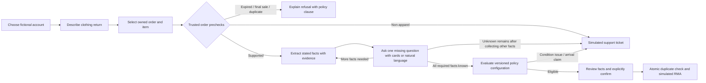
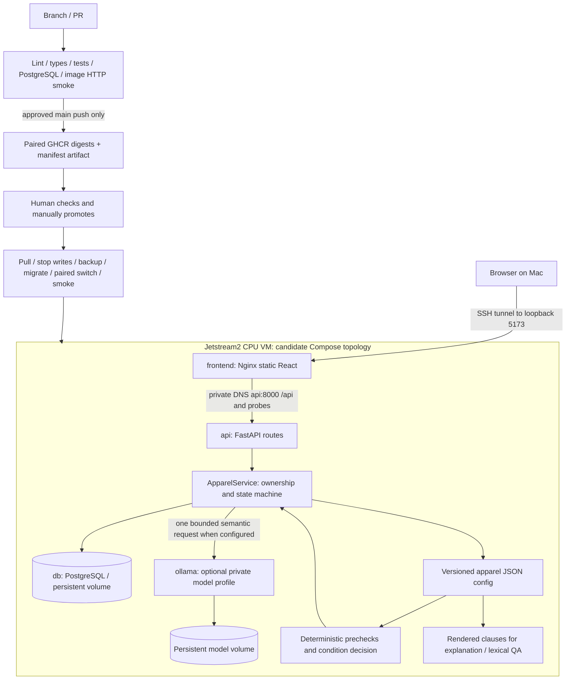

# Apparel workflow: interaction and technical architecture

These diagrams describe the candidate branch, NOT the current cloud's verified state.

## User interaction

Customer-caused adverse condition follows the policy's rejection action; arrival
issues/uncertain responsibility go to support. Worn alone does not imply rejection.
Nothing in this flow authorizes a real refund. Historical/unknown workflows are read-only.

## Technical boundary

Three default containers, four with the qualified model profile. PostgreSQL and
Ollama have no published host ports. API port 8000 and UI port 5173 bind to 127.0.0.1.
No new Qdrant deployment is required for the default policy implementation.

## Representative source map

| Responsibility | File / symbol |
|---|---|
| Render cards, send messages, restore state | `frontend/src/ApparelApp.tsx`: `run`, `select`, `submit` |
| HTTP client | `frontend/src/api.ts` |
| Chat and card routing | `app/api/v1/chat.py`, `app/api/v1/questions.py` |
| Signed fictional-account cookie | `app/services/demo_identity.py` |
| Order ownership, missing facts, tickets, final confirmation | `app/services/apparel_service.py`: `ApparelService` |
| Grounded model output, exact evidence validation | `app/extractors/apparel_llm.py`: `LLMFactExtractor` |
| Prompt definitions | `app/extractors/specs/apparel-llm-v1.md` |
| Single policy source / rendering | `app/policy/apparel.py`, `app/policy/apparel-1.0.0.json` |
| Additive schema and durable tickets | `migrations/versions/0004_apparel_workflow.py`, `app/db/models.py` |
| CI and image smoke | `.github/workflows/ci.yml`, `compose.ci.yml`, `scripts/smoke_apparel.py` |
| Manual promotion and rollback guard | `scripts/deploy_release.py`, `scripts/check_rollback.py` |
| CPU model gate | `scripts/qualify_apparel_model.py` |

Use symbol names rather than stale line numbers after edits; locate any symbol using
`rg -n 'def chat|def answer|def confirm|class ApparelService' app/services/apparel_service.py`.
The legacy rule/model classes remain for historical evaluation, not as the new
production semantic fallback. Configuration-based decisions and policy retrieval
are deliberately separate: retrieval explains, configuration authorizes.
