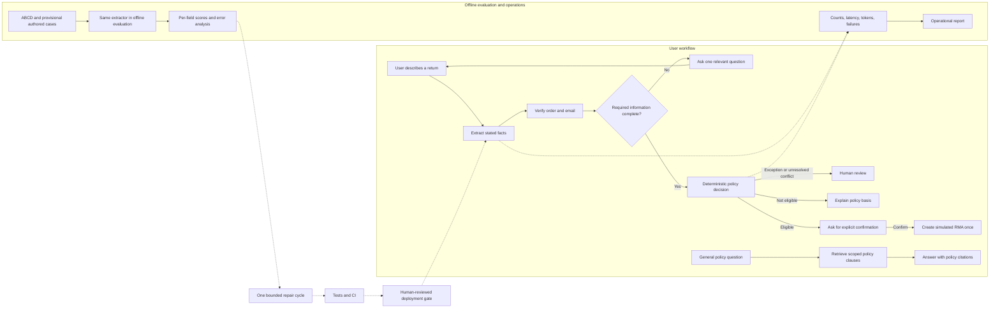
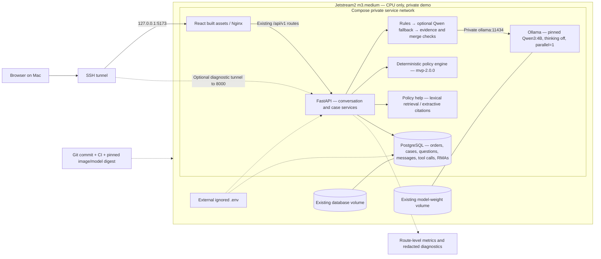

# ReturnFlow CPU deployment handoff — preparation, not deployment approval

This is a classroom demonstration with simulated policies and RMAs, not a live
refund service. The cloud instance remains Shelved during local work. v4 guardrails
and their paired validation are pending until the execution ledger says otherwise.
An architecture target is not evidence that the corresponding cloud test passed.

## High-level interaction and improvement loop



The server returns a question in the HTTP response; it does not hold an HTTP
request open while waiting for a user. The next message/answer is another request.
General policy help cannot answer a pending case question or approve an order.
The LLM proposes facts, not eligibility decisions or database writes.

## Technical deployment target



Only frontend/API loopback ports are published. PostgreSQL and Ollama are internal.
The default retrieval path does not require Qdrant or a second local embedding model.
The database intentionally stores conversation state; this is NOT a no-data-on-disk
architecture. Secrets, full evaluation traces and backups are excluded from Git.

## Acceptance worksheet

Run these only after explicit manual cloud approval, with a synthetic acceptance
database/order set. Do not delete historical RMAs to make a demo pass.

| Check | Evidence required | Current status |
|---|---|---|
| Reproducibility | Commit, Compose file, image digest, weight digest, policy/spec versions | Cloud acceptance pending |
| Startup | DB ready, migrations current, API ready, UI reachable through tunnel | Cloud acceptance pending |
| Model invocation | Actual rules-and-model path, not configuration alone | Local v3 smoke passed; v4/cloud pending |
| Cold/warm performance | First request after unloading vs warmed requests; tokens and p50/p95 | CPU measurements pending |
| Model unavailable | Unknown facts remain unknown; rule/button flow remains usable; no unsafe approval | v4 acceptance pending |
| Request timeout | Total model budget ≤60s, no repeated semantic retries | Existing unit coverage; cloud pending |
| Recovery | Restart services, reload persisted case, retain pending question and false facts | Local regression; cloud pending |
| Confirmation | No RMA before explicit confirmation; repeat confirmation/return is rejected or idempotent | Local regression; cloud pending |
| Backup/restore | Restore backup into a separate database, compare counts, run smoke there | Manual restore test pending |
| Rollback | Stop writes; use a schema-compatible code commit; retain existing volumes and records | Manual rehearsal pending |

`/health` means the process responds. `/ready` checks database/schema readiness,
not model availability. Container health alone does not prove successful inference.
One Ollama inference slot is not application-level admission control: avoid load
claims until simultaneous-user queueing/timeouts have been measured separately.

## Manual operating sequence

Use the existing `docs/jetstream-v2-runbook.md` for backup and migration commands.
Before using its deployment instructions, replace the old branch reference with
the exact reviewed v4 commit; no automatic checkout/reset or secret overwrite.

After manual Unshelve, verify the current public IP and SSH into the instance.
Keep existing passwords and volume identities. Validate Compose without printing
expanded secrets, then start only the required services:

```bash
cd ~/returnflow
docker compose -f compose.jetstream.yml config --quiet
docker compose -f compose.jetstream.yml --profile model up -d db api frontend ollama
docker compose -f compose.jetstream.yml ps
curl -fsS http://127.0.0.1:8000/ready
```

Open a tunnel on the Mac using the CURRENT address, not a saved historical IP:

```bash
ssh -N -o ExitOnForwardFailure=yes -L 15173:127.0.0.1:5173 exouser@CURRENT_PUBLIC_IP
```

Visit `http://localhost:15173`. Use the worksheet above before claiming acceptance.
Stop services before selecting Shelve, not Delete, in Exosphere:

```bash
docker compose -f compose.jetstream.yml --profile model stop
```

Close the Mac tunnel with Ctrl+C. Never run `down -v`, drop the live database, or
restore an old backup over new business records as an automatic rollback. A model
quality rollback can select the rules provider while preserving v2 conditions and
clarification; it must not revert to the old “unused means eligible” apparel policy.

## Release boundary

Automatic labels remain provisional. Missing/failed quality gates, unaudited labels,
or incomplete CPU acceptance block a formal model release. They do not prevent
preparing diagrams, reproducible configuration and safe rule/clarification tests.
No production authentication, public TLS deployment, refund payment integration,
high availability or PostgreSQL load/concurrency certification is claimed here.
